```mermaid
mindmap
  root((QA QC and ISTQB Test Process))
    Quality Assurance QA
      Process oriented
      Prevent defects
      Improve development and test processes
      Establish standards and procedures
      Review process compliance
      Use test results for continuous improvement
    Quality Control QC
      Product oriented
      Detect defects
      Evaluate product quality
      Verify specified requirements
      Validate stakeholder needs
      Includes testing and product evaluation
    Testing Roles
      Test Management Role
        Own overall test process
        Define objectives and approach
        Plan test activities and resources
        Monitor progress and risks
        Apply test control
        Lead test completion
      Testing Role
        Analyze test basis
        Identify test conditions
        Design test cases
        Prepare testware and environment
        Execute tests
        Record results and report defects
      Role Assignment
        Depends on project context
        One person may perform both roles
        Independence may improve objectivity
        Whole team contributes to quality
    Main Test Activities
      Test Planning
        Define test objectives
        Select test approach
        Estimate effort and resources
        Define schedule and completion criteria
      Test Monitoring and Control
        Compare actual progress with plan
        Evaluate test metrics
        Identify deviations and risks
        Take corrective actions
      Test Analysis
        Examine test basis
        Identify testable features
        Define and prioritize test conditions
        Assess defects in test basis
      Test Design
        Create and prioritize test cases
        Identify coverage items
        Define test data requirements
        Design test environment requirements
      Test Implementation
        Create test procedures and scripts
        Organize test suites
        Prepare test data
        Prepare test environment
        Build test execution schedule
      Test Execution
        Run tests
        Compare actual and expected results
        Record test results
        Analyze anomalies
        Report defects
      Test Completion
        Check unresolved defects and work products
        Create test completion report
        Archive reusable testware
        Record lessons learned
        Communicate completion status
    Important Test Work Products
      Planning Work Products
        Test plan
        Test schedule
        Risk register
        Entry and exit criteria
      Monitoring and Control Work Products
        Test progress reports
        Updated plans and schedules
        Test control directives
      Analysis Work Products
        Prioritized test conditions
        Defects in test basis
        Traceability links
      Design Work Products
        Test cases
        Test charters
        Coverage items
        Test data requirements
        Environment requirements
      Implementation Work Products
        Test procedures
        Automated test scripts
        Test suites
        Test data
        Test execution schedule
      Execution Work Products
        Test logs
        Actual results
        Test status
        Defect reports
      Completion Work Products
        Test completion report
        Archived testware
        Lessons learned
        Improvement actions
    Activity Relationships
      Planning guides all activities
      Monitoring and control operate continuously
      Analysis feeds design
      Design feeds implementation
      Implementation enables execution
      Execution provides feedback and defect information
      Completion evaluates objectives and consolidates results
      Traceability connects test basis testware results and defects
      Activities may overlap
      Activities may run iteratively or in parallel
      Findings may trigger feedback to earlier activities
```

Quality Assurance
Quality Assurance is process-oriented and emphasizes defect prevention. It establishes and improves the practices, standards and procedures used to develop and test a product. Information obtained through testing can also provide feedback for improving these processes.
Quality Control
Quality Control is product-oriented and focuses on detecting defects and evaluating whether the product satisfies requirements and stakeholder needs. Testing is an important QC activity because it produces evidence about product quality.
Testing Roles
ISTQB Foundation Level identifies two principal roles. The test management role is responsible for the overall test process, particularly planning, monitoring, control and completion. The testing role is responsible for the technical activities of analysis, design, implementation and execution. Assignment of these roles depends on context, and one person may perform both.
Main Test Activities
The test process contains planning, monitoring and control, analysis, design, implementation, execution and completion. These activities form a logical flow, but they are not required to occur as a strict waterfall sequence. They may overlap, repeat or run in parallel.
Important Test Work Products
Each test activity produces or updates testware. Examples include the test plan, test conditions, test cases, test charters, test procedures, automated scripts, test data, test logs, defect reports and the test completion report. Traceability connects these work products to the test basis and test results.
Activity Relationships
Planning establishes the direction of testing, while monitoring and control continue throughout the process. Analysis identifies what should be tested; design defines how it will be tested; implementation prepares the executable testware; execution produces results and defects; and completion consolidates the final status and lessons learned. Findings from later activities can cause earlier work to be revised.
The structure follows the official ISTQB Certified Tester Foundation Level Syllabus v4.0.1, especially Section 1.4 on test activities, testware and test roles.
