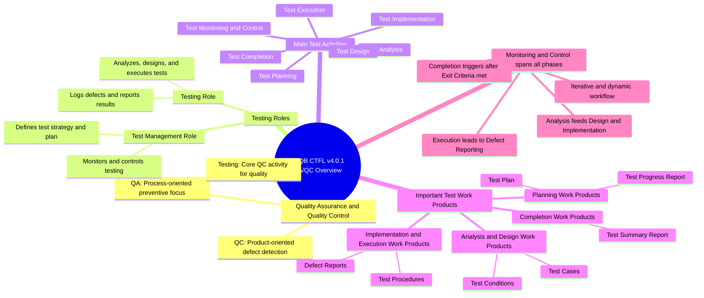

# ISTQB CTFL v4.0.1 QA/QC Role Mindmap

---

## Branch Explanations

### 1. Quality Assurance and Quality Control
Quality Assurance focuses on process improvement and defect prevention, whereas Quality Control focuses on identifying defects in the software product. Testing is a major Quality Control activity that measures software quality and mitigates defect risk.

### 2. Testing Roles
ISTQB CTFL v4.0 defines two primary role profiles: Test Management (focused on overall planning, governance, and control) and Testing (focused on hands-on analysis, design, execution, and defect reporting). Depending on team structure, these roles can be assigned to dedicated testers or shared across agile team members.

### 3. Main Test Activities
The test process consists of seven core activities that structure testing from project initiation to final release. These activities ensure structured test coverage, early defect discovery, and effective test management.

### 4. Important Test Work Products
Test work products are essential documentation and deliverables generated during test activities to track progress and results. Key examples include Test Plans, Test Cases, Defect Reports, and final Test Summary Reports.

### 5. Activity Relationships
Test activities interact dynamically, overlap, and repeat iteratively rather than following a strict linear sequence. Test Monitoring and Control runs continuously across all activities to provide direction and adapt to project changes.
