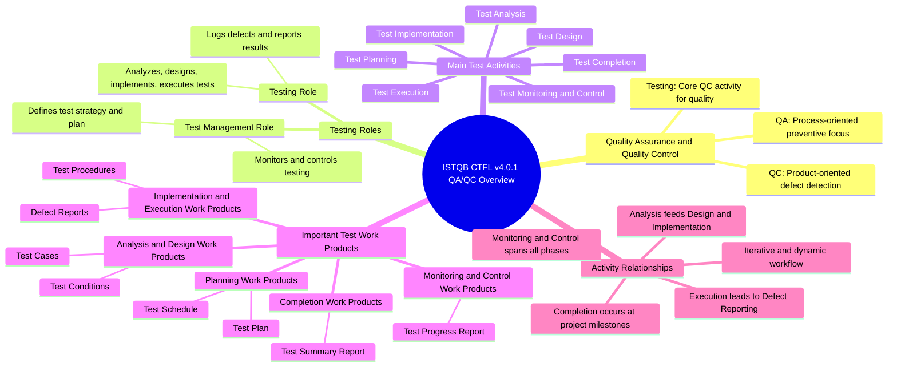

# Corrected ISTQB CTFL v4.0.1 QA/QC Role Mindmap

Reference: ISTQB Certified Tester Foundation Level Syllabus v4.0.1, Sections 1.4.1, 1.4.3 and 1.4.5.

## Branch Explanations

### 1. Quality Assurance and Quality Control

Quality Assurance focuses on process improvement and defect prevention, whereas Quality Control focuses on identifying defects in the software product. Testing is a major Quality Control activity that measures software quality and mitigates defect risk.

### 2. Testing Roles

ISTQB CTFL v4.0.1 defines two principal testing roles. The Test Management Role focuses mainly on planning, monitoring, control and completion, while the Testing Role focuses on analysis, design, implementation and execution.

### 3. Main Test Activities

The test process contains seven main activities. They form a logical workflow but can overlap, repeat or run in parallel depending on the project context.

### 4. Important Test Work Products

Test work products are produced by different test activities. For example, the test plan and schedule belong to planning, while the test progress report belongs to monitoring and control.

### 5. Activity Relationships

Monitoring and control continue throughout testing, while analysis, design, implementation and execution provide a logical flow. Test completion normally occurs at project milestones such as a release, the end of an iteration or completion of a test level.

## Exactly Three Corrections

| ID | Problem in the AI output | Student correction | ISTQB basis |
|---|---|---|---|
| M-01 | The Testing Role listed analysis, design and execution but omitted test implementation. | Added implementation to the Testing Role responsibilities. | Section 1.4.5 assigns test analysis, design, implementation and execution mainly to the Testing Role. |
| M-02 | `Test Progress Report` was classified as a planning work product. | Moved it under Monitoring and Control Work Products and used `Test Schedule` as a planning example. | Section 1.4.3 lists test progress reports under test monitoring and control, while test schedules are planning work products. |
| M-03 | Test completion was presented as occurring only after exit criteria are met. | Changed the relationship to milestone-based completion. | Section 1.4.1 states that test completion usually occurs at project milestones such as a release, the end of an iteration or test-level completion. |
