# Corrected QA/QC Role Mindmap

Reference: ISTQB Certified Tester Foundation Level Syllabus v4.0.1, especially Sections 1.2.2 and 1.4.1–1.4.5.

```mermaid
mindmap
  root((QA QC and ISTQB Test Process))
    Quality Assurance QA
      Process oriented
      Prevent defects
      Improve development and test processes
      Establish standards and procedures
      Review process compliance
      Use test results for continuous improvement
    Quality Control QC
      Product oriented
      Detect defects
      Evaluate product quality
      Verify specified requirements
      Validate stakeholder needs
      Testing is a form of quality control
    Testing Roles
      Test Management Role
        Overall responsibility for test process and team
        Lead test activities
        Focus on planning
        Focus on monitoring and control
        Focus on completion
      Testing Role
        Overall responsibility for technical testing
        Focus on analysis
        Focus on design
        Focus on implementation
        Focus on execution
      Role Assignment
        Depends on project and product context
        Depends on skills and organization
        One person may perform both roles
        Tasks may be shared by an Agile team
    Main Test Activities
      Test Planning
        Define test objectives
        Select a context appropriate test approach
      Test Monitoring and Control
        Monitor all test activities continuously
        Compare actual progress with the plan
        Take actions needed to meet objectives
      Test Analysis
        Analyze the test basis
        Identify testable features
        Define and prioritize test conditions
        Consider risks and risk levels
        Evaluate testability and defects in test basis and object
        Answer what to test
      Test Design
        Elaborate conditions into test cases and other testware
        Identify coverage items
        Define test data requirements
        Design environment requirements
        Identify infrastructure and tools
        Answer how to test
      Test Implementation
        Create or acquire executable testware
        Create procedures and manual or automated scripts
        Organize procedures into test suites
        Prepare test data
        Prioritize and schedule procedures
        Build and verify the test environment
      Test Execution
        Run tests according to the execution schedule
        Compare actual and expected results
        Log test results
        Analyze anomalies and likely causes
        Report anomalies based on observed failures
      Test Completion
        Create change requests or backlog items for unresolved work
        Identify and archive or hand over reusable testware
        Shut down the test environment to an agreed state
        Record lessons learned and improvements
        Create and communicate the completion report
    Important Test Work Products
      Planning Work Products
        Test plan
        Test schedule
        Risk register
        Entry criteria
        Exit criteria
      Monitoring and Control Work Products
        Test progress reports
        Documentation of control directives
        Information about risks
      Analysis Work Products
        Prioritized test conditions
        Defect reports for defects in the test basis
      Design Work Products
        Prioritized test cases
        Test charters
        Coverage items
        Test data requirements
        Test environment requirements
      Implementation Work Products
        Test procedures
        Manual and automated test scripts
        Test suites
        Test data
        Test execution schedule
        Test environment items
      Execution Work Products
        Test logs
        Defect reports
      Completion Work Products
        Test completion report
        Action items for improvement
        Documented lessons learned
        Change requests or product backlog items
    Activity Relationships
      Planning determines objectives and approach
      Monitoring and control continue throughout testing
      Analysis identifies what to test
      Design determines how to test
      Implementation prepares executable testware and environment
      Execution produces logged results and anomaly reports
      Completion consolidates status and future actions
      Activities are tailored to context
      Activities may overlap iterate or run in parallel
      Later findings may trigger earlier activities
    Cross-cutting Traceability
      Connects test basis and test conditions
      Connects risks and test cases
      Connects test cases and test results
      Connects results and defects
      Supports coverage evaluation
      Supports monitoring control reporting and audits
```

## Explanation of the main branches

- **Quality Assurance and Quality Control:** QA is process-oriented and preventive, while testing is a product-oriented form of QC that helps detect defects and evaluate quality.
- **Testing Roles:** ISTQB CTFL defines a test management role and a testing role. Their assignment depends on context, and the same person may perform both.
- **Main Test Activities:** Planning establishes objectives and approach; monitoring and control run continuously; analysis, design, implementation and execution develop and run the tests; completion consolidates results and follow-up actions.
- **Important Test Work Products:** The work products are grouped according to the activity that produces them, using the lists in Section 1.4.3.
- **Activity Relationships:** The activities have a logical relationship but are tailored to context and may be iterative, overlapping or parallel.
- **Cross-cutting Traceability:** Traceability is maintained across the process rather than being owned only by test analysis.

## Exactly three corrections made

| ID | Original AI issue | Correction in this version | ISTQB basis |
|---|---|---|---|
| M-01 | `Traceability links` were placed under analysis work products. | Traceability was moved to a cross-cutting branch connecting the test basis, testware, results and defects. | Section 1.4.4 |
| M-02 | Monitoring/control products omitted risk information and substituted updated plans and schedules. | The branch now contains progress reports, documentation of control directives and information about risks. | Section 1.4.3 |
| M-03 | Completion products included archived testware but omitted change requests. | Archiving remains a completion activity; the work products now include action items, documented lessons learned and change requests. | Sections 1.4.1 and 1.4.3 |

Full reasoning and the AI-assistance disclosure are recorded in `ai/mindmap/review-notes.md` and `ai/ai-audit-report.md`.
